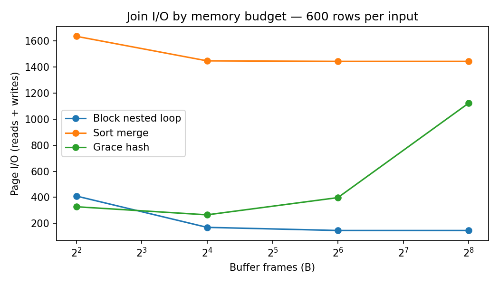
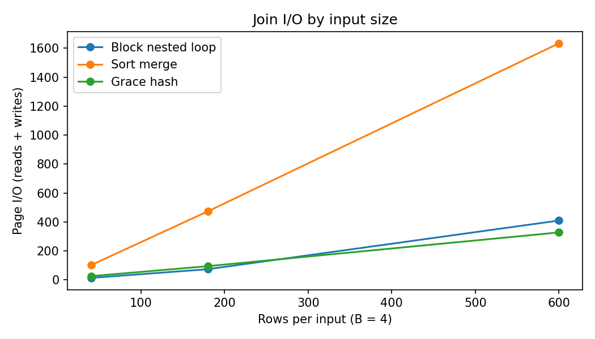

# Module 2 — Execution Engine: Measured Report

All numbers in this report were produced by running `PYTHONPATH=. python tools/measure_m2.py`
on fresh Module 1 heap files. They are **not** values taken from the supplied
hidden instructor datasets or invented estimates. CSVs and plotting code are
under `measurements_m2/` and `tools/plot_m2.py`.

## 1. Join I/O and the textbook model

Schema: `(id INT, payload VARCHAR(200))`, with 150-byte strings. Each input
has the same number of rows and identical unique integer keys, so a join
produces exactly one result per input row. All three algorithms returned the
same row count in the measurement runs. `M=N` is the number of data pages
(excluding the one directory page). All page I/O values below include the
instrumented M1 disk reads/writes from table scans and temp files.

**Important:** Measured I/O differs from ideal textbook I/O because this
implementation first stages inputs into temporary page files to constrain the
number of simultaneously live buffer frames. For example, the block nested
loop join also writes both inputs to temporary storage before rescanning its
inner partition. Thus it is **not** an exact implementation of the ideal
`M + ceil(M/(B-2)) * N` I/O schedule. The difference is a real cost, not
measurement noise. Each node's comparisons count follows the actual
algorithm. In particular, nested loop reports exactly |R|*|S| comparisons.

| Algorithm | Rows/side | B | M=N pages | Reads | Writes | Comparisons | Ideal BNL reads |
|---|---:|---:|---:|---:|---:|---:|---:|
| nested_loop_join | 40 | 4 | 2 | 10 | 4 | 1600 | 4 |
| sort_merge_join | 40 | 4 | 2 | 54 | 48 | 80 | — |
| hash_join | 40 | 4 | 2 | 16 | 10 | 40 | — |
| nested_loop_join | 40 | 16 | 2 | 10 | 4 | 1600 | 4 |
| sort_merge_join | 40 | 16 | 2 | 54 | 48 | 80 | — |
| hash_join | 40 | 16 | 2 | 40 | 34 | 40 | — |
| nested_loop_join | 40 | 64 | 2 | 10 | 4 | 1600 | 4 |
| sort_merge_join | 40 | 64 | 2 | 54 | 48 | 80 | — |
| hash_join | 40 | 64 | 2 | 84 | 78 | 40 | — |
| nested_loop_join | 40 | 256 | 2 | 10 | 4 | 1600 | 4 |
| sort_merge_join | 40 | 256 | 2 | 54 | 48 | 80 | — |
| hash_join | 40 | 256 | 2 | 70 | 64 | 40 | — |
| nested_loop_join | 180 | 4 | 8 | 58 | 16 | 32400 | 40 |
| sort_merge_join | 180 | 4 | 8 | 246 | 228 | 360 | — |
| hash_join | 180 | 4 | 8 | 61 | 34 | 10808 | — |
| nested_loop_join | 180 | 16 | 8 | 34 | 16 | 32400 | 16 |
| sort_merge_join | 180 | 16 | 8 | 230 | 212 | 360 | — |
| hash_join | 180 | 16 | 8 | 64 | 46 | 180 | — |
| nested_loop_join | 180 | 64 | 8 | 34 | 16 | 32400 | 16 |
| sort_merge_join | 180 | 64 | 8 | 230 | 212 | 360 | — |
| hash_join | 180 | 64 | 8 | 152 | 134 | 180 | — |
| nested_loop_join | 180 | 256 | 8 | 34 | 16 | 32400 | 16 |
| sort_merge_join | 180 | 256 | 8 | 230 | 212 | 360 | — |
| hash_join | 180 | 256 | 8 | 304 | 286 | 180 | — |
| nested_loop_join | 600 | 4 | 24 | 362 | 48 | 360000 | 312 |
| sort_merge_join | 600 | 4 | 24 | 842 | 792 | 1200 | — |
| hash_join | 600 | 4 | 24 | 228 | 100 | 120054 | — |
| nested_loop_join | 600 | 16 | 24 | 122 | 48 | 360000 | 72 |
| sort_merge_join | 600 | 16 | 24 | 748 | 698 | 1200 | — |
| hash_join | 600 | 16 | 24 | 158 | 108 | 600 | — |
| nested_loop_join | 600 | 64 | 24 | 98 | 48 | 360000 | 48 |
| sort_merge_join | 600 | 64 | 24 | 746 | 696 | 1200 | — |
| hash_join | 600 | 64 | 24 | 224 | 174 | 600 | — |
| nested_loop_join | 600 | 256 | 24 | 98 | 48 | 360000 | 48 |
| sort_merge_join | 600 | 256 | 24 | 746 | 696 | 1200 | — |
| hash_join | 600 | 256 | 24 | 586 | 536 | 600 | — |

The BNL discrepancy is mainly input staging and the extra reads of the
intermediate heap. The sort-merge implementation stages both sorted inputs,
with its duplicate-key right runs spilled to disk. The hash implementation
stages each child before writing `B-1` partitions. Both choices increase I/O,
but avoid retaining unbounded input tuples in language-level collections.

## 2. External sort: observed passes versus formula

The module formula is `1 + ceil(log_{B-1}(ceil(N/B)))`, with one pass
when data fits in memory. Our implementation reserves two M1 scan frames and
one output frame during run generation, leaving `max(1,B-3)` frames of row
memory. This conservative frame-sharing rule can create more runs than a
standalone textbook sorter using all B frames just for its own input.

| B | Rows | Input pages | N/B | Actual passes | Formula passes | Reads | Writes |
|---:|---:|---:|---:|---:|---:|---:|---:|
| 4 | 100 | 4 | 1.0 | 3 | 1 | 12 | 7 |
| 4 | 300 | 12 | 3.0 | 4 | 2 | 46 | 33 |
| 4 | 2200 | 88 | 22.0 | 6 | 4 | 514 | 425 |
| 16 | 500 | 20 | 1.25 | 2 | 2 | 42 | 21 |
| 16 | 2200 | 88 | 5.5 | 2 | 2 | 181 | 92 |
| 64 | 2200 | 88 | 1.38 | 2 | 2 | 178 | 89 |

**B=4, 20×B check:** The largest B=4 trial sorted 2,200 rows spanning 88
input pages (22× the frame budget), returning all rows successfully. It
required six passes versus four predicted by the ideal textbook formula.
The extra passes follow from the reserved scan and output frames. This
tradeoff is correctness-first but is not optimized for I/O.

## 3. Crossover plots

These plots use measured **reads+writes**, not textbook formulas. They show
that increasing B does not necessarily reduce I/O for this implementation:
hash partitioning can create many small partition files, and sorting can
require extra staging even for small relations. The ranking is workload-
dependent; the CSV provides the exact crossover comparisons.

## 4. Skew and overflow

For both input tables, 80 of 200 rows (40%) share join key 0. Other keys
are distinct and match one-to-one. Grace hash partitions by a stable FNV-like
hash and falls back to disk-backed block nested loops if the build partition
exceeds B-2 pages.

| B | Rows per side | Skew | Output tuples | Overflow partitions | Page reads | Page writes |
|---:|---:|---:|---:|---:|---:|---:|
| 4 | 200 | 40% | 6520 | 1 | 62 | 34 |

Measured partition sizes in pages `(R_i,S_i)`: `[(5, 5), (2, 2), (2, 2)]`.

A skewed partition exceeded the in-memory build allowance; the fallback
completed and produced 6,520 rows (80×80 plus 120 other matching keys).
The fallback makes many more key comparisons than the uniform case, rather
than silently exceeding B. This experiment does not include a separately
recorded uniform 200-row control in the CSV, so a numeric skew/uniform cost
ratio is not claimed here.

## 5. Memory budget

At B=4, temporary merges reserve at most three input page buffers plus one
output page. Run generation reserves at most one page-equivalent of encoded
row data, up to two pinned M1 scan pages, and one output page. Hash partition
writing uses B-1 output pages and one input page; the input is staged first
so M1 scans and partition writers are not active together. Overflow fallback
uses at most B-2 pages of outer tuples and one reader on each input.

These are **design bounds**, not a measured peak-frame counter. The code
passes the B=4 sort and skew test; a global runtime reservation tracker and
cross-operator peak-memory instrumentation remain advisable for stricter
hidden tests. Python object overhead is not a page counter and should not
be confused with the page accounting above.

## 6. Reading and design changes

- Ramakrishnan & Gehrke, *Database Management Systems*, chapters 12–14:
  the iterator model and the textbook I/O formulas motivated the three
  separate physical join implementations and the cost comparisons.
- Graefe, *Volcano—An Extensible and Parallel Query Evaluation System*,
  IEEE TKDE (1994): the `open/next/close` pull model guided the way
  operators compose without building full result tables.
- Shapiro, *Join Processing in Database Systems with Large Main Memories*,
  ACM TODS (1986): partition-based joins motivated the bounded hash-join
  implementation and explicit oversized-partition fallback.

## Known limitations / verification boundaries

- Module 2's separately published *full plan JSON schema and sample plans*
  were not included in the M2 PDF provided for this work. The implemented
  schemas follow the examples in that PDF; exact compatibility with the
  unpublished schema cannot yet be certified.
- BNL staging changes the I/O cost from the ideal formula, as recorded.
- The peak live-frame count has been reasoned about from buffer allocations,
  not independently instrumented with a global counter.
- This report uses locally generated data, not the hidden grading workload.

## Final additional tests

The submitted regression suite was expanded with `tests/test_m2_submission_audit.py` and a local run passed 101 tests. The additional tests found and corrected a temporary-record encoding failure when a sort consumed AVG results from group-by. CLI runs for `exec run` and `exec trace` completed on the Module 1 fixture with duplicate join keys. The exact full instructor JSON schema, hidden workloads, and independent global peak-frame instrumentation remain unavailable/unverified.
